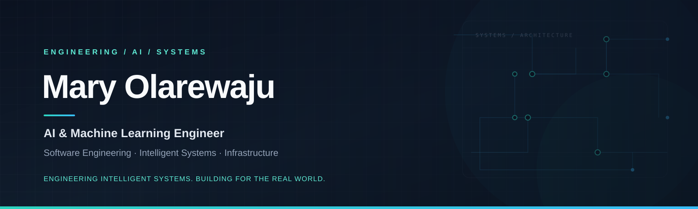

  

  
  
  
  
  
  
  
  
  
  
  
  

## About

I build and deliver software across machine learning and general software engineering. My work takes solutions from problem definition and design through implementation, testing, and deployment.

I focus on writing sound code, making considered technical decisions, and building applications that are maintainable, efficient, and dependable. I work across software development, machine learning, backend engineering, and infrastructure, with an emphasis on building systems that perform reliably and solve practical problems.

---

## Engineering Disciplines

**Artificial Intelligence & Machine Learning**

Machine learning applications, predictive modelling, natural language processing, model development, and evaluation.

**Software & Backend Engineering**

Application development, API design, backend services, data processing, and software architecture.

**Systems & Infrastructure**

Cloud computing, deployment, containerisation, orchestration, automation, and infrastructure engineering.

**Systems Quality & Performance**

Software testing, debugging, performance optimisation, reliability, scalability, and maintainability.

---

## Technical Capabilities

| Area | Technologies & Focus |
|---|---|
| **Programming Languages** | Python, C++, SQL, Bash |
| **Machine Learning** | PyTorch, TensorFlow, scikit-learn, Hugging Face, Transformers, NLP |
| **LLM Engineering** | LLMs, RAG, AI Agents, Agentic Workflows, LangChain, LangGraph, Prompt Engineering |
| **Backend Engineering** | FastAPI, Flask, Django, REST APIs, Microservices |
| **Data Engineering & Storage** | Pandas, NumPy, PostgreSQL, SQLite, Vector Databases |
| **Cloud & Infrastructure** | AWS, Docker, Kubernetes, Linux, Cloud Deployment |
| **MLOps & Software Delivery** | ML Pipelines, Model Deployment, CI/CD, Git, GitHub Actions, Monitoring |
| **Systems Engineering** | Distributed Systems, System Design, Performance Optimisation, Reliability, Scalability |

---

<h2 align="center">Contact</h2>

  
  &nbsp;
  

